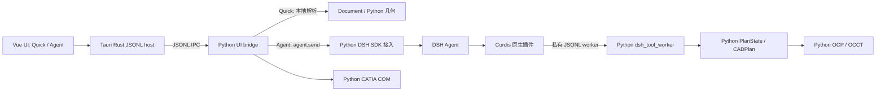

# 当前系统事实与迁移分支审计

**审计日期：**2026-10-02

**主线基线：**`main@3abd8164960ff5639abf504f9e1d44261b9c53c7`。本文“主线当前实现”只描述这个提交中的代码。

**迁移分支：**`feat/rust-dsh-acp-host@56f3dc0780deb749701432e3a65c65712009cbd5`，尚未合入上述主线。分支实现另列，不得当作 main 已有能力。

**审计方式：**源码静态追踪、Git 提交比较和既有验证记录检查；本次未启动桌面应用或发起模型请求。

可重取审计源代码：`git show 3abd816:<仓库相对路径>`。当前 checkout 文件可能已经包含迁移分支改动，因此引用主线时必须使用这一固定 commit。

## 1. 主线实现（main@3abd816）

| 子系统 | 可追溯源码 | 已实现职责 | 当前边界 |
|---|---|---|---|
| Vue 桌面界面 | `src/apps/desktop/src/App.vue`，主线符号：模式选择、`backendCall('model.quick_build')`、`backendCall('agent.send')` | 提供快速建模和 Agent 模式；Agent 输入可携带参考图，快速模式走本地文本解析 | UI 只能证明调用了后端命令，不能证明 DSH 收到图片或生成了正确模型 |
| Tauri 宿主 | `src/apps/desktop/src-tauri/src/lib.rs`，主线符号：`ensure_backend`、`send_backend_call`、`backend_call` | 启动常驻 Python JSONL bridge，并做 UI IPC 与进程生命周期管理 | Agent 会话和 CAD 领域状态不是 Rust 所有 |
| Python UI bridge | `src/legacy/ai_modeler/ui/bridge.py`，`dispatch`、`model.quick_build`、`agent.send`、`_run_agent` | 快速模式用本地解析器；Agent 模式交给 Python Agent 接入层并返回文档/预览 | 两条产品模式在主线都经过 Python bridge |
| DSH 接入 | `src/legacy/ai_modeler/agent/dsh_agent.py`，`run_dsh_agent`；`src/legacy/ai_modeler/agent/dsh_native_tools.mjs`，`apply` | Python DSH SDK 驱动会话；Cordis 插件通过 DSH 原生接口注册工具，不需要 MCP CAD 转译 | “原生插件注册”不等于 CAD 计算已迁出 Python；工具 schema 与执行仍由 Python worker 提供 |
| 工具与计划状态 | `src/legacy/ai_modeler/agent/dsh_tool_worker.py`、`dsh_tool_backend.py`、`plan_state.py`、`src/legacy/ai_modeler/sdk/cadplan.py` | Python worker 收取 Cordis JSONL 请求；Python 维护增量 PlanState、CADPlan 校验、Document 转换和输出 | Rust 尚未拥有 CADPlan schema、验证器或特征事务 |
| 几何核心 | `src/legacy/ai_modeler/core/geometry/occ_kernel.py`，`inspect_shape`、OCCT B-Rep 构建与检查 | Python OCP/cadquery-ocp 驱动 OCCT 并返回拓扑/尺寸类数据 | 本地 B-Rep 报告不构成视觉相似或 CATIA 几何验收 |
| CATIA | `src/legacy/ai_modeler/catia_backend/` 与 `src/legacy/catia_plugin/` | Python COM、cscript 宏生成、CATIA 插件安装及交互 | Python 不限于 CATIA adapter；“最终只保留 COM”仍是迁移目标 |
| 记录与资源 | `src/legacy/ai_modeler/paths.py`、`src/legacy/ai_modeler/agent/dsh_agent.py` | Python Agent run/observability 记录通过 `temp_path('agent-logs', ...)` 进入仓库 `temp/`；运行期配置另有用户数据目录 | 日志是否完整记录 provider 实际请求/图片内容，须逐 run 检查；API key 不应进入证据包 |

### 主线数据流



此图是固定主线提交上的静态源码路径，不是一次端到端运行记录。插件是 DSH 原生 Cordis 插件；Python worker 是应用私有 JSONL 边界，不是 MCP。

## 2. 未合入主线的迁移分支进展

`feat/rust-dsh-acp-host@56f3dc0` 新增了 Rust ACP stdio client、私有固定版本 DSH/Node runtime 安装器和 Rust Agent Host。该分支的 Agent 模式改由 Vue 调用 Tauri `agent_send`，Rust 管理 DSH ACP 初始化、session 创建/恢复/取消/关闭、图像 ACP content block 和 thought/tool/status 事件；Quick 模式仍走 Python bridge。分支源码路径为 `src/apps/desktop/src-tauri/src/agent_host.rs`、`src/apps/desktop/src-tauri/src/acp.rs` 和 `src/apps/desktop/src/App.vue`；这些文件内容须从 `git show 56f3dc0:<路径>` 读取，不能作为 main 文件链接。

这不是完整的 Rust Agent 工具链：Cordis 插件仍调用 `dsh_tool_worker` 子进程，CADPlan、PlanState 和 OCCT 仍在 Python。Agent Host 的 session 与图像清单写入应用用户数据目录；它不能据此宣称所有 DSH 交互日志已经统一落在仓库 `temp/`。未来若统一试验留档，应显式从应用数据目录导出经过脱敏的证据。

### 迁移分支的既有验证记录与边界

功能分支的验收摘要位于 `docs/06-roadmap/02-f1-acp-host.md`（该卡与 F1 代码尚未合入 main）。该记录报告：Rust 单测与前端构建通过；固定私有 DSH ACP 的 initialize、session/new、重启后的 session/resume、reasoning option 和 session/close 可用；profile 可加载 Cordis 工具。记录明确指出**没有发送 `session/prompt`，没有使用密钥发起 provider 请求**。因此这些证据只支持静态连接、配置解析、ACP 控制面及插件注册层级，不能支持模型建模质量、图片到 provider 的真实传递、多模态复核或 CATIA 结论。本审计没有重跑这些命令；若需要复核原始过程，应补齐关联的原始 stdout/stderr、manifest/hash 和逐请求事件文件。

## 3. 旧资料归档检查

截至 2026-10-02 的目录盘点：

- 新版 `docs/` 有 11 个文件，均为当前章程、架构/方法、研究记录模板、设计、操作和迁移文件。
- `temp/legacy-documents/` 有 56 个旧文档文件；历史报告、实验数据、模型、图片和运行证据归入 `temp/evidence-archive/` 等 `temp/` 子目录。`temp/` 合计 1,193 个文件（递归且包含隐藏文件）。
- 不能把“所有旧文本都已进入 temp”作为已证实结论：`src/legacy/kb/`、`src/legacy/prompts/`、`src/legacy/datasets/` 中保留运行时实际读取的知识、提示词和数据；桌面端和遗留包中的 README 也仍随相应源码保存。根级 `README.md` 与 `CONTRIBUTING.md` 是当前说明文件，不属于历史归档。
- 因此已证实的边界是：旧版文档库/报告/产物已归档；被运行时消费的旧资源及组件说明仍在 `src/`。后者不应仅因内容较早就移入 `temp/`，否则会破坏资源路径。

复核目录计数的 PowerShell 命令：

```powershell
(Get-ChildItem -LiteralPath docs -Recurse -File -Force).Count
(Get-ChildItem -LiteralPath temp/legacy-documents -Recurse -File -Force).Count
(Get-ChildItem -LiteralPath temp -Recurse -File -Force).Count
```

## 4. 尚未由当前证据回答的问题

1. main 当前实际使用的 DSH/provider/model/route 是否逐次配置一致，图片是否完整经过 SDK、Cordis 附件和 provider 上行；静态代码不足以证明。
2. 未合入分支中的 Rust ACP Host 是否能在真实请求中持续保留原图、多轮上下文并正确处理中断；控制面验收尚未覆盖 prompt。
3. Agent 自审查差异是否可定位、返修是否提高独立几何和图像指标；现有单次成功或模型自评不能回答。
4. CADPlan/工具定义、OCP 与拟迁移的 Rust 几何层是否等价；需要冻结 fixtures、双实现对拍及容差。
5. CATIA 导出结果能否重新打开并通过实际几何测量；本地 STL/预览和 cscript 成功返回都不足以证明。
6. 历史数据集中是否存在答案泄漏、标签定义漂移、尺寸真值不足或失败样本缺失；需按[验证协议](../02-methods/01-validation-protocol.md)盘点后再做性能结论。
