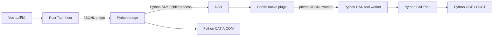

# 当前系统审计与迁移前基线

**审计日期：2026-10-02。** 下表描述仓库代码结构，不代表桌面安装版在本机已通过完整运行验收。

## 当前实现

| 区域 | 代码证据 | 当前职责 | 迁移差距 |
|---|---|---|---|
| Vue + Tauri 桌面 | [`src/apps/desktop/src/App.vue`](../../src/apps/desktop/src/App.vue)、[`src/apps/desktop/src-tauri/src/lib.rs`](../../src/apps/desktop/src-tauri/src/lib.rs) | Vue 工作区；Rust 管理常驻 Python JSONL bridge、桌面 IPC、依赖安装和资源定位 | Rust 尚未拥有 Agent 会话或 CAD 领域状态 |
| Python bridge | [`src/legacy/ai_modeler/ui/bridge.py`](../../src/legacy/ai_modeler/ui/bridge.py) | 提供 Agent、快速建模、文档、导出、设置和 CATIA 等 UI 方法 | 桌面业务仍大量转交给 Python |
| DSH 接入 | [`src/legacy/ai_modeler/agent/dsh_agent.py`](../../src/legacy/ai_modeler/agent/dsh_agent.py)、[`src/legacy/ai_modeler/agent/dsh_native_tools.mjs`](../../src/legacy/ai_modeler/agent/dsh_native_tools.mjs) | 通过 Python DSH 接入层启动/控制 DSH；Cordis 插件注册原生工具，但 CAD 工具执行边界仍回到 Python worker | 尚未切换为 Rust 管理的 DSH ACP 会话，也未做到 Python 只留 CATIA COM |
| CADPlan 与 Agent 状态 | [`src/legacy/ai_modeler/sdk/cadplan.py`](../../src/legacy/ai_modeler/sdk/cadplan.py)、[`src/legacy/ai_modeler/agent/plan_state.py`](../../src/legacy/ai_modeler/agent/plan_state.py) | Python 验证、预览、构建 CADPlan，维护增量建模状态 | 领域类型、状态事务和验证器仍由 Python 实现 |
| 几何内核 | [`src/legacy/ai_modeler/core/geometry/occ_kernel.py`](../../src/legacy/ai_modeler/core/geometry/occ_kernel.py) | 通过 Python OCP/cadquery-ocp 建立和检查 B-Rep | 没有 Rust/C++ thin FFI，也没有 Rust 几何核心 |
| CATIA | [`src/legacy/ai_modeler/catia_backend/`](../../src/legacy/ai_modeler/catia_backend/) 与 [`src/legacy/catia_plugin/`](../../src/legacy/catia_plugin/) | Python COM、宏生成和插件安装 | 这是最终仍可保留 Python 的目标边界；迁移期间还存在大量非 CATIA Python 代码 |
| 安装运行时 | [`src/legacy/scripts/build_desktop_resources.mjs`](../../src/legacy/scripts/build_desktop_resources.mjs)、[`src/apps/desktop/src-tauri/tauri.conf.json`](../../src/apps/desktop/src-tauri/tauri.conf.json) | 目前打包 Python 源码与 CPython；首次启动安装 Python 依赖 | DSH/Node/Cordis/runtime 组合没有单一签名/校验的应用版本清单 |

## 当前数据流

这是代码结构的静态概述。实际 provider 请求、消息流、图片内容和模型调用结果须在运行时记录中核验。

## 结构迁移中的路径边界

- `src/legacy/` 是旧 Python 应用的过渡工作根；其包内 `PROJECT_ROOT` 仍指向该工作根以维持资源相对路径。
- `REPOSITORY_ROOT` 指仓库；根级 `docs/`、`.github/` 和仓库元数据不属于旧 Python 应用资源目录。
- 开发生成记录经 `temp_path()` 写入仓库 `temp/`；打包运行经用户数据目录保存临时数据。
- 桌面 app 资源包仍扁平化为 `app/ai_modeler`、`app/prompts`、`app/kb` 等旧 Python 预期路径。后续 runtime manifest 需取代这种隐式目录假设。

## 尚缺的运行证据

本次重构需验证路径迁移后的 Python 自检、pytest、Vue build、Rust tests、桌面资源 staging 和 CI workflow 路径。重新布局本身不能证明图片 Agent、DSH ACP、CATIA COM 或模型质量已经验收。
