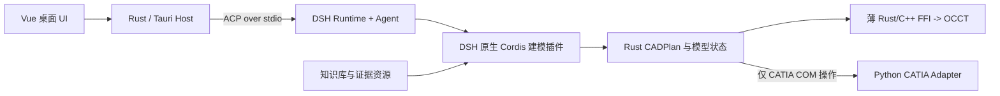

# 目标架构：Rust 桌面宿主、DSH Agent 与原生建模插件

## 职责边界

- **Rust/Tauri** 管理桌面生命周期、版本化 runtime、DSH ACP 会话、取消/恢复、CADPlan 状态、资源路径和 UI 事件。Rust 作为宿主，不替代 DSH 决定 Agent 下一步。
- **DSH** 持有 Agent 决策、模型/推理配置、会话上下文与工具调用选择。
- **Cordis 插件** 用 DSH 原生插件接口注册 CAD、知识检索、图片/几何检查等工具。CAD 工具不再经过 MCP 转译层或 Python DSH SDK。
- **Rust CAD domain** 持有版本化计划、特征事务、参数和几何验证。OCP/OCCT 通过范围受控的 Rust/C ABI 执行几何，不向模型暴露任意代码。
- **Python** 最终只保留确实依赖 CATIA COM 的 Windows 适配器；迁移完成前 `src/legacy/` 仍承担旧功能。
- **Vue** 只渲染交互界面和实时事件，不复制 Agent 决策策略。

## Agent/runtime 连接选择

采用 DSH ACP 作为 Rust host 与 DSH runtime 的进程协议，理由是官方 DSH ACP 文档描述了独立 session 的创建、列表、恢复、关闭、取消和语义更新，并说明图片输入取决于附件存储与选定 route 的图像能力。图片验收必须实际验证本项目选定的 DSH、provider 和模型组合。[DSH ACP 说明](https://github.com/deepseek-ai/deepseek-harness/blob/master/packages/acp/acp/README.md)

DSH TypeScript SDK client 通过 stdio JSON-RPC 启动并驱动 Harness runtime，适用于 TypeScript host；本项目选择 ACP 是为了 session 生命周期与取消/恢复语义。它们是宿主进程协议，不是 CAD MCP 工具代理。[DSH TypeScript client 文档](https://github.com/deepseek-ai/deepseek-harness/blob/master/packages/sdk/client/README.md)

CAD 功能作为 Cordis 原生插件执行；不能因为 ACP server 可选挂载 MCP，就把 CAD 工具重新注册为 MCP server。协议与建模工具注册是两个不同边界。

## 运行时固定与升级

应用发布版本携带机器可读 runtime manifest，精确列出已交付运行时的兼容版本和 SHA-256 来源。桌面端按该清单获取应用私有 Node/DSH Runtime；新版本在暂存目录安装，校验通过后切换，失败则恢复上一版。manifest 未来可扩展至 OCCT native payload 与 CATIA adapter，但这些当前不属于 DSH Runtime manifest 的已交付范围。

截至 F1.3，Node/DSH manifest、私有安装、版本校验、暂存切换和失败恢复已有实现；Rust ACP Host、会话恢复及 Tauri Agent 事件也已接入。固定 DSH 的控制面与 Cordis 装载已经过隔离验证。已安装桌面端完整演练、真实模型请求、原图到 provider 的传输、CAD 工具实建和几何验收仍未完成，见[F1 ACP 验收卡](../06-roadmap/02-f1-acp-host.md)与[迁移 Todo](../06-roadmap/01-migration-todo.md)。

## 会话与事件

Rust host 为每个会话保存 DSH session id、当前 CADPlan revision、原始图片引用、用户约束、活动工具调用与最后成功的几何版本。ACP 更新经过 Rust 转换为稳定的 UI 事件：思考/消息、工具开始与完成、预览更新、取消、错误、恢复与使用量。终止一个会话必须只影响该会话，并在关闭/取消后回收其 runtime 资源。

Rust 不要把整段内部链路“重新 Agent 化”；它只执行明确的宿主职责和事务约束。工具次数熔断应根据时间、资源和重复动作确定，不用小的固定调用上限替代模型决策。

## 分阶段迁移原则

1. 先把旧代码和证据归位，恢复并固定构建/测试入口。
2. 构建 Rust ACP host 与运行时清单，保留现有桌面 UI 协议，验证文字、图片、取消和续话。
3. 将 CADPlan 类型、校验和增量事务迁入 Rust，逐项切断 Agent tool 对 Python worker 的依赖。
4. 建立 OCCT Rust/C++ thin FFI，用 golden fixtures 比较迁移前后 B-Rep、包围盒、拓扑和网格指标。
5. 将 Quick 模式、导出和 CATIA 桥接调整到稳定的 Rust 核心；最后缩减 Python 到 CATIA COM。

每个阶段独立验收、独立提交。目录重构先提交到 `main`，后续 feature 保持单独提交。
