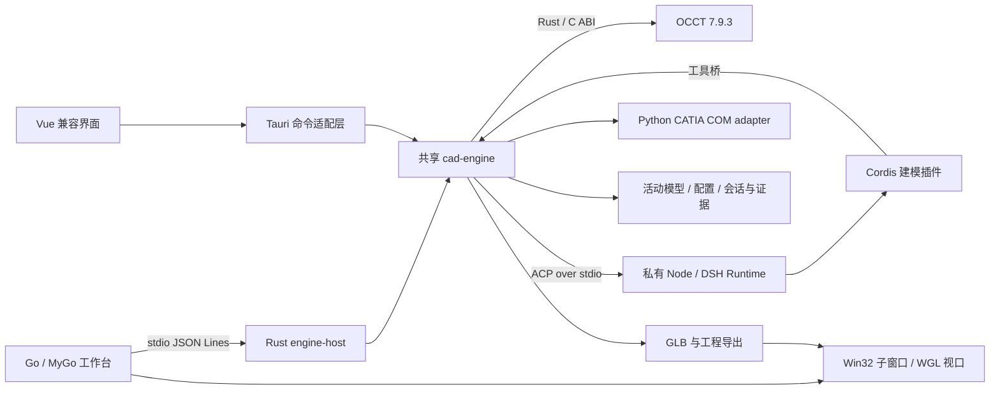

# MyGo 桌面、Rust 引擎与共享 CAD 核心

2026-11-20 的桌面迁移将默认窗口入口放在 `src/apps/native-desktop`。Go/MyGo 提供工作台，`src/apps/engine-host` 提供常驻 Rust 进程，建模和会话实现集中在 `src/core/cad-engine`。Vue/Tauri 兼容桌面直接调用同一核心。[构建与运行](../05-operations/03-native-desktop-build.md)

## 进程和模块边界



| 路径 | 责任 |
| --- | --- |
| `src/apps/native-desktop/cmd/formrecall` | 程序入口、运行路径和启动选项 |
| `src/apps/native-desktop/internal/workbench` | 自定义窗口栏、需求输入、特征编辑、设置、案例、状态和用户操作 |
| `src/apps/native-desktop/internal/engine` | 启动子进程、请求编号、异步响应、事件和关闭 |
| `src/apps/native-desktop/internal/viewport` | GLB 解析、相机、原生 OpenGL 子窗口和画面捕获 |
| `src/apps/engine-host` | JSON Lines 解析、请求调度、模型写互斥、并发取消和 shutdown |
| `src/core/cad-engine` | CADPlan、Quick、参数编辑、OCCT、工程与验收状态、Agent、配置、目录和运行时 |
| `src/apps/desktop/src-tauri` | Tauri 生命周期、上下文构造和命令、Channel 适配 |
| `src/native` | OCCT C ABI 桥接和运行时构建 |
| `src/legacy` | 保留的 Python 功能、CATIA adapter、提示与知识资源，以及 DSH 插件资源 |

核心 crate 默认依赖与窗口无关。原 Rust 域模块、资源和测试随实现迁入核心，Tauri 通过 path dependency 及公开导出保留现有命令和示例。MyGo 与 Tauri 各自构造 `EngineContext`，提供资源、数据、配置及打包路径。

## 原生工作台

Go 模块固定 MyGo v0.9.1。MyGo 管理隐藏系统标题栏后的窗口拖动区、最小化、最大化和关闭操作，工作台使用 MyGo 控件，文件与消息对话框及平台弹出菜单调用系统能力。

界面采用中性深灰、蓝色选择状态和统一的 SVG 图标。设置使用分类侧栏、独立滚动表单及固定操作栏。按钮颜色反馈持续 120 ms，分类切换为 140 ms，设置进入和退出分别为 160 ms 与 120 ms。属性栏和日志栏通过实际宽高插值展开，三维子窗口跟随每帧布局更新。系统减少动画偏好会直接应用面板位置和尺寸。

视口使用独立 Win32 子窗口和 WGL 上下文，提供深度测试、模型边线、网格、坐标指示、旋转、平移、缩放及视图切换。WGL 窗口直接挂在应用根 HWND 下，与 `MyGoSurface` 同级，并维持在其上方。布局坐标从 MyGoSurface 映射到根窗口客户区，避免界面交换链覆盖嵌套的原生视口。GLB 在后台加载，较新的加载结果覆盖旧请求。相机过渡在完成或隐藏时停止计时，系统减少动画偏好会直接应用目标视角。设置遮罩出现时保存真实模型帧作为背景，隐藏子视口，退出过渡结束后恢复交互。

`CaptureWindow` 合成 MyGo 内容和 OpenGL 帧缓冲，用于模型与布局诊断。桌面显示验收读取隔离窗口客户区对应的 Windows 桌面像素，核对原生视口可见性及已呈现前缓冲的模型像素。动画录制同样使用桌面像素，覆盖实际窗口合成与设置关闭后的视口恢复。

视口加载自包含 GLB 三角网格，支持节点变换、法线和基础颜色。纹理、骨骼、动画、稀疏 accessor、Draco 压缩和外部 buffer 尚未实现。实际窗口、DPI 和性能验证范围记录在迁移验证文档。[验证记录](../05-operations/04-native-desktop-validation.md)

## 桌面与核心进程协议

引擎启动参数为 `--resources PATH --data PATH [--config PATH]`。标准输出每行一个 JSON 对象，标准错误用于诊断。请求的 `id` 是 `uint64`，`method` 沿用现有命令名，`params` 使用 camelCase 字段。

```json
{"id":1,"method":"quick_build","params":{"text":"创建 100×60×20 毫米长方体","revision":1}}
{"id":1,"result":{"state":"complete"}}
{"id":2,"method":"active_model_snapshot","params":{}}
{"id":2,"error":"示例错误信息"}
{"event":"agent","request_id":3,"data":{"event":"agent.message","request_id":"native-turn-id","data":{"text":"示例消息"}}}
```

示例响应仅展示协议字段。`quick_build` 实际返回完整文档。外层事件 `request_id` 关联数字 RPC 请求，内层原有 WireEvent 使用 `event`、字符串轮次 `request_id` 和 `data`。工作台按当前轮次过滤过时事件。

`active_model_snapshot` 返回完整活动记录，包含 `document`、`generation`、`geometry_fingerprint` 和 `acceptance_projection`，无活动模型时返回 `null`。Quick、新建、更新、导入和保存命令返回文档，工作台在需要验收状态时重新获取 snapshot。尺寸、体积和网格分别取自 `document.stats.size`、`document.stats.volume` 与 `document.mesh_path`。

JSON Lines 宿主以互斥锁串行处理模型写请求，核心提交继续校验预期 generation。Agent 流式执行期间，取消请求可以独立调度。Go 客户端按编号匹配响应，子进程退出或协议损坏时结束挂起调用。写入排队遵循请求取消，部分写入被取消时终止连接以保护 JSON Lines 边界。关闭时请求 `shutdown`，4 秒期限后强制结束宿主，再等待最多 1 秒回收。

## 状态和验收

活动模型由 Rust 持久化，Go 维护其展示副本和编辑草稿。界面仅在宿主投影的活动 generation、CAD revision、几何指纹与 finish summary 一致且明确确认验收时显示“已验收”。裸文档返回、过时事件或工程中的自报验收字段会经过重新核对。审核案例写入也由核心检查当前模型的验收依据。

真实回归已通过 Quick、特征数值和数组编辑、保存、进程重启恢复、重新导入及文件导出。Quick 生成的有效几何在该回归中保持候选状态，验收需要相应复核证据。[跨进程回归记录](../05-operations/04-native-desktop-validation.md#真实引擎与工作台回归)

默认用户数据目录为 `%LOCALAPPDATA%/com.aimodeler.desktop`。Go 将路径显式传给引擎。配置文件依次采用显式 `--config`、`AIMODELER_CONFIG_PATH`、`AIMODELER_DATA_DIR/config.json`，最后使用数据目录下的 `config.json`。资源目录兼容 `AIMODELER_RESOURCE_ROOT` 和 `AIMODELER_ROOT`。运行脚本的数据目录参数与显式配置可用于隔离验证环境。

## Agent 与外部运行时

Rust 核心保留 DSH ACP 会话、图片暂存、历史、流事件、取消与运行时安装能力。DSH 承担 Agent 决策与工具选择，Cordis 插件注册 CAD、检索和复核工具，Rust 执行明确的工具命令并管理模型事务。Python 继续承载保留功能与按需 CATIA COM 适配。

DSH/Node 和 OCCT 各自使用运行时清单与 SHA-256 校验。原生包包含两套程序、必要资源、OCCT DLL 与许可证，DSH 由应用私有运行时安装流程准备。外部 provider 请求、图像传输和 CATIA COM 需要各自的实际环境复验。迁移中的 ACP 夹具测试只覆盖协议、流事件与取消行为。

## 构建和兼容维护

根目录 `npm run dev` 启动原生桌面，`build:native`、`test:native`、`package:native` 对应原生构建、检查与打包。`npm run dev:tauri` 和 `npm run dev:web` 分别保留 Tauri 桌面与 Vue 浏览器预览。具体命令以根目录 `package.json` 和脚本为准。[原生构建指南](../05-operations/03-native-desktop-build.md)

核心测试与进程协议测试可独立运行。历史 Tauri 测试入口转向核心域测试，Tauri IPC 测试仍在适配 crate 中验证注册和 Channel 行为。新增功能需同时核对适用的核心、RPC 和兼容命令边界。当前全量测试仍保留 23 项已复现的基线失败，迁移验证按日志报告通过、失败和忽略数量。[迁移验证与基线](../05-operations/04-native-desktop-validation.md)
